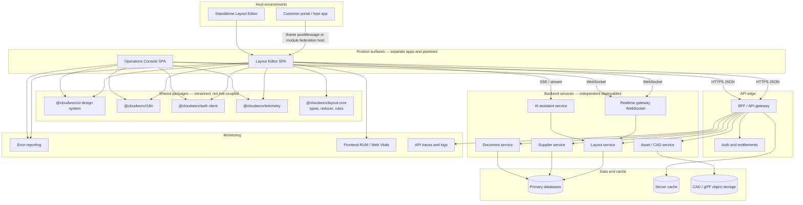
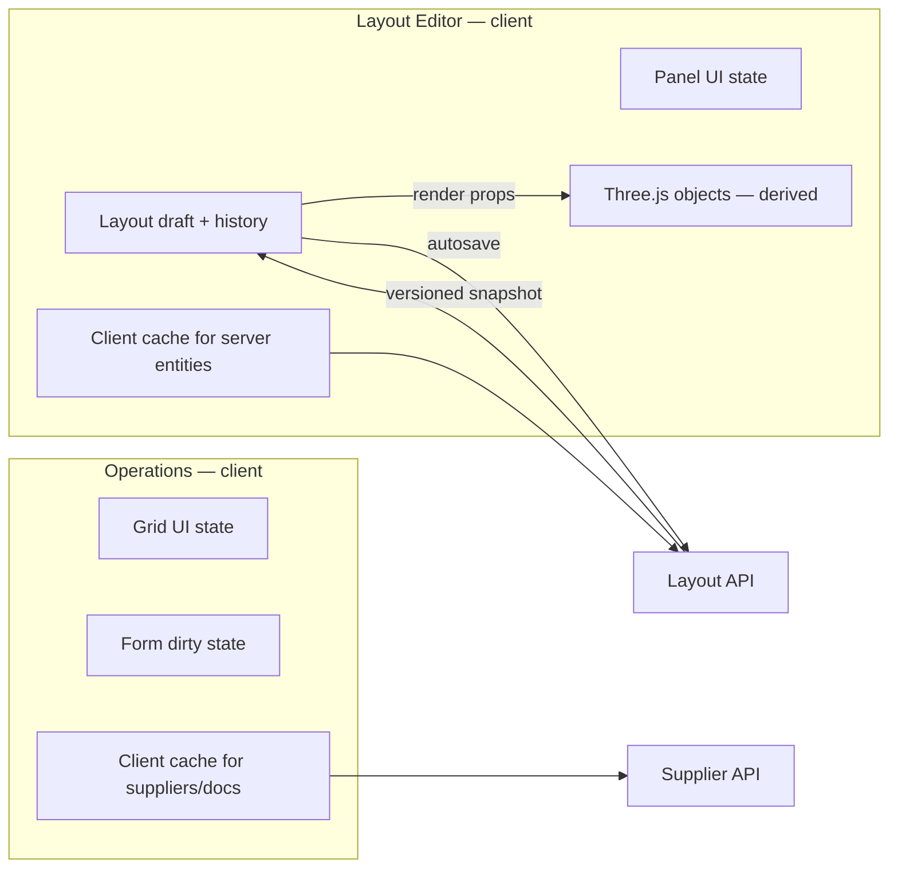
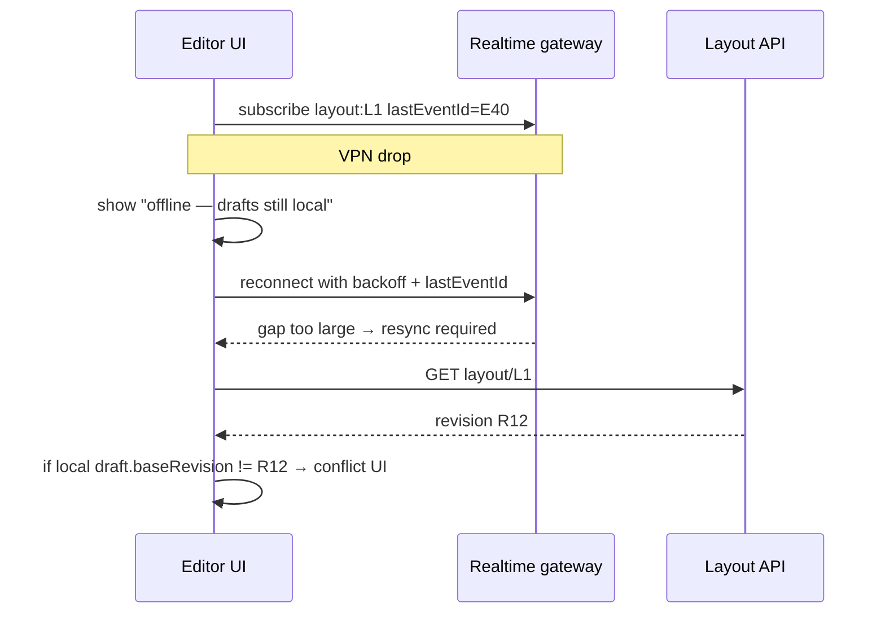
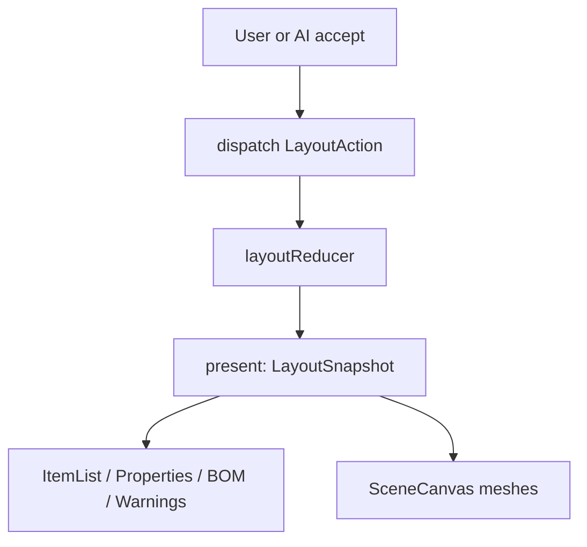
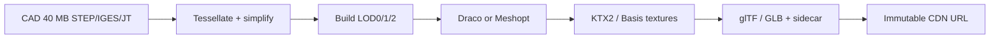
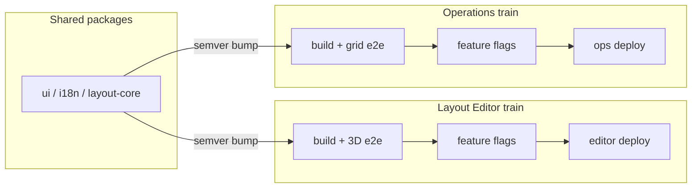
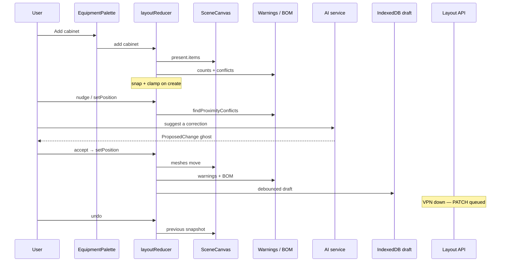

# Cloudworx Frontend Architecture

**Layout Editor prototype and production design**

| | |
| --- | --- |
| Document type | Architecture design and implementation report |
| Audience | Cloudworx frontend assessment reviewers |
| Source of truth | This repository (`cloudworx-layout-editor`) |
| Prototype stack | React 19, TypeScript, Vite 8, Three.js, React Three Fiber |
| Document date | 16 October 2026 |
| Scope of this pass | Documentation only. Application code was not modified. |

This document has two jobs. **Part A** proposes a production architecture for two product surfaces that share a design system but ship on separate release trains. **Part B** reports honestly what this repository implements today. **Part C** records the decisions a frontend engineer should be able to defend in a design review.

The prototype is a working in-browser 3D layout editor. It is not a backend-integrated product. Features that exist only as design are labeled **proposed**. Numbers for performance, transfer size, and frame rate are **proposed targets**, not measurements from this codebase.

---

## Table of contents

1. [How to read this document](#how-to-read-this-document)
2. [Repository snapshot](#repository-snapshot)
3. [Part A — Architecture design](#part-a--architecture-design)
   - [1. High-level system architecture](#1-high-level-system-architecture)
   - [2. Frontend state and data flow](#2-frontend-state-and-data-flow)
   - [3. Large enterprise grids and forms](#3-large-enterprise-grids-and-forms)
   - [4. Localization and accessibility](#4-localization-and-accessibility)
   - [5. Embedding and security](#5-embedding-and-security)
   - [6. 3D editor architecture](#6-3d-editor-architecture)
   - [7. CAD and 3D asset optimization](#7-cad-and-3d-asset-optimization)
   - [8. AI assistant architecture](#8-ai-assistant-architecture)
   - [9. Testing, CI/CD and monitoring](#9-testing-cicd-and-monitoring)
   - [10. End-to-end example](#10-end-to-end-example)
4. [Part B — Current Prototype: Implemented vs Planned](#part-b--current-prototype-implemented-vs-planned)
5. [Part C — Decisions and trade-offs](#part-c--decisions-and-trade-offs)
6. [Assumptions](#assumptions)
7. [Appendix: source map](#appendix-source-map)

---

## How to read this document

| Label | Meaning |
| --- | --- |
| **Implemented** | Code in this repository supports the behavior. |
| **Partially implemented** | Some of the behavior exists; important gaps remain. |
| **Not implemented** | No supporting code in the application source. |
| **Not verified** | The repository suggests the capability, but this documentation pass did not run or measure it. |
| **Proposed** | Production design. Not present in the prototype. |

Verification limits for this pass:

- Source files under `src/`, `package.json`, `README.md`, Vite/TypeScript config, and an existing `dist/` folder were inspected.
- Automated tests were **not** run: `package.json` has no `test` script and there are no application test files under `src/`.
- `npm run build` was **not** re-executed, to avoid rewriting `dist/`. A prior production bundle exists (`dist/assets/index-CH3Q1RK3.js`, dated 14 October 2026, about 1.2 MB uncompressed). Whether the current source still compiles was **not verified** in this pass.
- Interactive 3D drag, 500-item performance, screen-reader output, and keyboard traversal of the canvas were **not** exercised in a browser for this document.

---

## Repository snapshot

```
src/
  App.tsx                 # useReducer + language state + layout of panels
  i18n.ts                 # en / vi dictionaries
  index.css               # application layout and focus styles
  main.tsx                # React 19 createRoot
  features/layout/
    layoutTypes.ts        # domain types, room, snap, clamp, factory
    layoutReducer.ts      # add / select / move / rotate / delete / undo / redo
    layoutRules.ts        # center-to-center proximity
  components/
    SceneCanvas.tsx       # R3F scene (render-only)
    EquipmentPalette.tsx
    PropertiesPanel.tsx
    ItemList.tsx
    BillOfMaterials.tsx
    Toolbar.tsx
```

Runtime dependencies (`package.json`): `react`, `react-dom`, `three`, `@react-three/fiber`, `@react-three/drei`. There is no data-fetching library, no i18n framework, no state library beyond React, and no test runner.

Scripts: `dev`, `build` (`tsc -b && vite build`), `lint`, `preview`.

---

## Part A — Architecture design

### 1. High-level system architecture

#### 1.1 Two product surfaces, one platform

**Assumption.** Cloudworx ships two customer-facing surfaces that share visual language and authentication, but have different users, risk profiles, and release cadences:

| Surface | Primary users | Typical work | Release pressure |
| --- | --- | --- | --- |
| **Layout Editor** | Plant / layout engineers | 3D placement, clearance, BOM | Slower; 3D and CAD changes need extra QA |
| **Operations Console** | Procurement, document control | Supplier lists, document grids, forms | Faster; copy, filters, and workflow fixes |

They must not share a single deployable that forces a clearance-rule change to wait on a supplier-grid hotfix, or the reverse.

#### 1.2 Proposed system diagram



#### 1.3 What is shared versus independent

| Shared (versioned packages) | Independent (per product) |
| --- | --- |
| Design tokens, buttons, forms, dialogs, data-grid primitive | App shell, routing, feature flags |
| i18n runtime and message pipeline | Product copy and feature-specific strings |
| Auth session helper, token refresh policy | Entitlement checks that are product-specific |
| Telemetry SDK (error + performance envelopes) | Dashboards and alert routing |
| `layout-core`: types, reducer, snap/clamp, clearance rules | Three.js scene, CAD loader, AI preview UI |
| Typed embed contract (see §5) | Host-specific adapters |

**Why this split.** A shared npm (or internal registry) package is consumed at build time. Layout Editor can stay on `@cloudworx/ui@1.4` while Operations ships `@cloudworx/ui@1.5`. That avoids coupling release cycles. Sharing a runtime “god module” or a single SPA with feature flags for every screen would force both trains through the same build.

**Do not share:**

- Scene graph objects, Three.js, or React Three Fiber with Operations. Operations should never import WebGL.
- Supplier/document query keys with the editor. Different invalidation needs.
- AI prompt templates with Operations workflows unless a dedicated package is versioned on purpose.

#### 1.4 State boundaries



- **Layout draft** is local, high-frequency, and undoable. It is the source of truth while the user edits.
- **Server layout document** is the durable source of truth after save. It carries a revision id.
- **Three.js objects** are a view of the draft. They are not stored and must not be mutated as if they were domain data.
- **Operations grids** are server-state heavy. The client cache holds pages, not the full 200,000-row document set.

#### 1.5 Realtime and AI in the same picture

- Layout collaborators (proposed) subscribe to `layout:{id}` on the WebSocket gateway.
- The AI service streams **proposals**, not applied mutations. The editor validates and previews them locally (see §8).
- Monitoring is a sidecar of every app: the UI never talks to Sentry/Datadog-style vendors through ad-hoc `fetch` in feature code; it uses the shared telemetry SDK so both trains emit the same envelope.

---

### 2. Frontend state and data flow

#### 2.1 Server state versus local UI state

| Kind | Examples | Owner | Survives refresh? |
| --- | --- | --- | --- |
| Server state | Saved layout revision, supplier row, document metadata, entitlements | Backend + client cache | Yes, via API |
| Draft / session state | In-progress layout items, undo stacks, AI ghost proposal | Editor reducer | Only if autosave/recovery is implemented |
| Ephemeral UI state | Selected id, orbit camera, open dialog, language toggle | React `useState` | No (language may be persisted as a preference) |

**Prototype today.** All layout data is local UI/draft state in `useReducer` (`src/App.tsx`). There is no server state, no client cache library, and no persistence.

**Production example — moving a cabinet**

1. User nudges cabinet `cabinet-2` by +0.5 m on X.
2. Reducer commits a new `LayoutSnapshot` (same as today’s `nudge` action).
3. UI and scene re-render from `present`.
4. Debounced autosave sends `{ revision, patch }` to the layout service.
5. Client cache marks the layout query as `fresh` on `200` with the new revision.
6. If the PATCH fails, the draft stays on screen (user work is not discarded) and a “save failed” banner appears. The undo stack is **not** rewritten by the server error.

#### 2.2 Server caching and invalidation

**Proposed client cache** (React Query, SWR, or equivalent — not in this repo):

| Query | Key | Stale time | Invalidation |
| --- | --- | --- | --- |
| Layout document | `['layout', layoutId]` | Short (e.g. 30 s) while editing | On successful save; on WebSocket `layout.updated` if revision is newer |
| Equipment catalog | `['catalog', locale]` | Long (e.g. 1 h) | Catalog version header change |
| Supplier page | `['suppliers', filters, sort, cursor]` | Short | Filter change; mutation of a visible row |
| Document page | `['documents', filters, sort, cursor]` | Short | Same pattern |

**Proposed server cache** (CDN/edge or Redis in front of read APIs):

- Cache **catalog** and **static CAD derivatives** by content hash.
- Do **not** cache in-progress drafts at the edge.
- Cache supplier list pages with keys that include tenant, filters, and sort. Invalidate on write for that tenant, or use short TTL plus ETag.

**Invalidation example.** Operations edits supplier `S-4412`. Mutation `PATCH /suppliers/S-4412` succeeds. The client invalidates `['suppliers']` queries for that tenant, not a global wipe of document queries. The editor does not refetch suppliers unless it has an open picker.

#### 2.3 Optimistic updates and rollback

Use optimism only where the user can understand a flash of old data.

| Action | Optimistic? | Rollback |
| --- | --- | --- |
| Rename a supplier in a grid cell | Yes | Restore previous cell value; toast the error |
| Delete a document | Yes, with undo toast | Re-insert the row if DELETE fails |
| Apply an AI layout proposal | **No** until the user accepts. After accept, it is a local reducer commit, then autosave | Autosave failure does not undo the local accept; it retries |
| Rotate equipment in the editor | Local history commit immediately (already true in the prototype) | Undo locally; server patch is separate |

**Rollback must not fight undo.** If a save fails after a local rotate, keep the rotated item. Offer Retry. Do not automatically dispatch `undo`.

#### 2.4 Draft state, autosave, and recovery

**Prototype:** refresh loses the layout. There is no `localStorage`, IndexedDB, or API.

**Proposed:**

```text
draft = { layoutId, baseRevision, present, past, future, updatedAt, clientId }
```

1. On each `commit` in the reducer, write the draft to IndexedDB (debounced, e.g. 300–500 ms).
2. Every N seconds or after idle, PATCH the server with a **patch** against `baseRevision`.
3. On load: if IndexedDB draft is newer than server and `baseRevision` still matches, restore it and prompt “Recover unsaved layout?”.
4. Cap `past` (see §6) before persisting so recovery payloads stay small.
5. Never persist access tokens in IndexedDB next to the draft.

#### 2.5 WebSocket disconnects, reconnects, and stale data (VPN)

Industrial users often sit on flaky VPNs. Treat disconnect as normal.



Rules:

- Heartbeat and exponential backoff with jitter. Do not tight-loop reconnect.
- Send `lastEventId` (or revision) on resume. If the server cannot fill the gap, **full refetch**, do not apply partial events onto a possibly forked draft.
- While offline, keep editing the local draft. Queue autosaves. Disable “someone else is editing” indicators until the socket is healthy.
- After reconnect, compare `baseRevision`. If the server moved, go to conflict handling rather than silently overwriting.

#### 2.6 Conflict handling

**Same user, two tabs.** Last successful revision wins on the server. The losing tab is told “This layout was saved elsewhere” and offered Reload or Keep local copy (export).

**Two users.** Operational transform is usually more cost than this product needs. Prefer:

1. Soft lock: `GET` includes `lockedBy`. Warn, do not hard-block if the lock expires.
2. Version check: `If-Match: revision` on PATCH. `409` returns the server snapshot.
3. UI: three-way summary — “Server moved machine-1 to X=2; your draft has X=4.” Merge by item id. Do not auto-merge overlapping fields.

**AI versus human.** An accepted AI proposal is just another local commit with the same revision rules. It must not bypass `If-Match`.

---

### 3. Large enterprise grids and forms

**Assumption.** Operations Console must show on the order of **50,000 suppliers** and **200,000 documents**. The Layout Editor prototype does not contain these grids.

#### 3.1 Do not load the full set into the DOM

A React list of 200,000 DOM rows will not stay interactive. The strategy is:

1. **Server-side** filter, sort, and keyset pagination (cursor), not “load all then sort in the browser”.
2. **Windowed rendering** (row virtualization) for the page that *is* in memory, typically 50–200 rows fetched, ~20–40 visible.
3. **Column virtualization** if a document row has dozens of columns.
4. **Stable row keys** from server ids (`supplierId`, `documentId`), never array index.

#### 3.2 Filtering, sorting, search

| Concern | Approach |
| --- | --- |
| Sort | Send `sort=name:asc` to the API. Database index must match the default sort. |
| Filter | Structured fields (country, status) as query params. |
| Search | Debounce input **250–400 ms**. Cancel in-flight request on each new term (`AbortController`). Minimum 2–3 characters unless the user submits. |
| Empty and error | Dedicated empty, loading, and retry states — not a blank table. |
| URL | Persist filters in the query string so back/forward and shared links work. |

**Example.** Typing `nguy` in the supplier search should not fire four API calls that all complete out of order. Debounce, abort, and ignore responses whose `requestId` is not the latest.

#### 3.3 Rendering performance

- Memoize row components. Pass a stable `onRowClick` or use event delegation.
- Avoid putting the entire grid state in one Context that changes every keystroke.
- Do not store derived “selected row objects” if the id is enough.
- For cells with heavy formatters (locale currency), format only visible rows.

#### 3.4 Forms, dirty state, unsaved warnings

| Topic | Proposed behavior |
| --- | --- |
| Schema | Field-level schema (e.g. Zod) shared with the API contract where possible |
| Dirty | Compare form values to the last loaded server entity; not “touched” alone |
| Submit | Disable double submit; show per-field errors from `400` |
| Navigation | `beforeunload` plus in-app router prompt when dirty |
| Autosave forms | Optional for long documents; show “Saved 12:04” vs “Unsaved” |

#### 3.5 Keyboard and accessibility in grids

- Arrow keys move the focused cell; `Enter` edits; `Escape` cancels.
- `aria-rowcount` / `aria-colcount` reflect the **filtered server total**, not the window size, when the grid is a true table. Virtualization libraries need extra work to keep this honest.
- Do not rely on hover-only actions. Row actions must be reachable by keyboard.
- Sticky header and a visible focus ring (`:focus-visible` is already used in this prototype’s CSS — reuse that token in the design system).

#### 3.6 Proposed performance targets (not measured)

These are **design targets** for Operations Console on a mid-range laptop (e.g. 8 GB RAM, integrated GPU) over a 20 Mbps VPN. They are **not** results from this repository.

| Metric | Proposed target | How to measure |
| --- | --- | --- |
| Time to first grid paint (skeleton) | &lt; 1.5 s after route change on warm cache | Performance marks `grid:start` → `grid:firstPaint` |
| Time to first 50 rows of data | &lt; 2.5 s p75 | Mark when page JSON applied |
| Scroll | Keep main thread event handlers under 50 ms p95 | Profiler + `Long Task` API |
| Filter keystroke | UI stays responsive; network after debounce | Trace input handler duration |
| Memory | Stay well below tab crash range for a 50k-backed view (only one page resident) | Chrome Performance monitor during a 10-minute filter session |
| Form open | &lt; 300 ms to interactive for a typical document form | Marks around dialog mount |

Manual checks: keyboard walk of a 200k-backed document grid; screen reader row announcements; VPN throttle in DevTools.

---

### 4. Localization and accessibility

#### 4.1 Languages

| Locale | Prototype | Production |
| --- | --- | --- |
| English (`en`) | Implemented in `src/i18n.ts` | Keep as default |
| Vietnamese (`vi`) | Implemented UI strings | Extend to dates, numbers, pluralization |
| Simplified Chinese (`zh-CN`) | **Not implemented** | Add a third dictionary and locale pack |

The prototype stores a flat `messages.en` / `messages.vi` map and `t(lang, key)`. `index.html` stays `lang="en"` even when Vietnamese is selected. Palette size hints (`1.0 × 1.0 m`) are hard-coded English/Latin numerals in `EquipmentPalette.tsx`.

#### 4.2 Locale-aware dates, numbers, and currency

**Proposed:** `Intl.DateTimeFormat`, `Intl.NumberFormat`, `Intl.PluralRules` with a locale selected from the user profile, not from the browser alone (a user in Hanoi may still want `en` UI with `vi-VN` number format — make this an explicit setting).

| Data | Example policy |
| --- | --- |
| Layout meters | 1 decimal, locale decimal separator (`0.5` vs `0,5`) |
| Currency on supplier quotes | ISO currency code from the record, not assumed USD |
| Dates on documents | ISO storage; display in the user locale; always show timezone on export |

The prototype formats distance with `toFixed(2)` (always period) in `App.tsx`, while Vietnamese copy uses a comma in “0,6 m”. That inconsistency should be fixed with `Intl` in production.

#### 4.3 Dictionary management and pluralization

- Extract messages to JSON (or ICU) files, not a TypeScript object, so translators do not edit application code.
- Use ICU MessageFormat for plurals (`{count, plural, one {# cabinet} other {# cabinets}}`) and for Vietnamese classifiers if needed.
- CI check: every locale file has the same keys; `t()` is typed (`MessageKey` already exists in the prototype and is a good seed).
- Do not concatenate translated fragments (`t('are') + name`). Keep full sentences in the dictionary so grammar can change.

#### 4.4 WCAG 2.2 AA — proposed bar

| Area | Prototype evidence | Production gap |
| --- | --- | --- |
| Semantic structure | `header`, `main`, `aside`, `h1`/`h2`, `fieldset`/`legend`, BOM `table` | 3D canvas has no text alternative besides the item list |
| Keyboard | Undo/Redo/Delete shortcuts; buttons are real `<button>`; `:focus-visible` in `index.css` | Canvas meshes are not in the tab order; no skip link; no arrow-key move except nudge buttons |
| Focus | Language group has `role="group"` and `aria-label` | Dialogs (none yet) will need focus trap |
| Warnings | `aria-live="polite"` on proximity list | Conflict color in 3D is red; do not rely on color alone — the list and badge already add text |
| Contrast | Not measured | Measure panel text, grid lines, and 3D selection colors |
| Language | EN/VI toggle | Set `document.documentElement.lang`; add `zh-CN` |

**3D and accessibility.** The accessible representation of the layout is the **item list + properties + warnings**, not the WebGL canvas. Production should keep those panels complete so a keyboard and screen-reader user can select, move, rotate, and delete without the canvas.

#### 4.5 Testing localization and accessibility

**Automated (CI):**

- i18n key parity across `en`, `vi`, `zh-CN`
- axe-core (or equivalent) on Operations routes and editor chrome (not the WebGL canvas)
- eslint-plugin-jsx-a11y

**Manual:**

- VoiceOver / NVDA on the warning live region and item list
- Keyboard-only placement and undo
- Vietnamese and Chinese screenshots for truncation
- Zoom 200% on the panel layout (the prototype already has a simple `@media` break at 1100 px; that is not a full responsive a11y pass)

---

### 5. Embedding and security

**Proposed.** The Layout Editor can run standalone or inside a host (customer portal) as an **iframe**. Module federation is an alternative for teams that already operate a microfrontend platform; iframe isolation is the default recommendation because WebGL, CSP, and credentials are easier to reason about.

This is **not implemented** in the prototype.

#### 5.1 Why messages must be validated

`postMessage` delivers attacker-controlled data if any other window can obtain a reference to the iframe. The editor must:

1. Ignore messages from origins not on an allowlist.
2. Validate `type` and payload shape (schema).
3. Never execute strings as code.
4. Never trust a token that arrived in a message without also binding it to the session established over HTTPS.

Wildcard `targetOrigin: '*'` is unacceptable for tokens, layout payloads, or user identity.

#### 5.2 Typed contract (illustrative — not real credentials)

```ts
type HostToEditor =
  | { type: 'host.ready'; requestId: string }
  | { type: 'host.locale'; locale: 'en' | 'vi' | 'zh-CN' }
  | { type: 'host.openLayout'; layoutId: string; revision?: string }
  | { type: 'host.session'; expiresAt: string } // no access token in the message

type EditorToHost =
  | { type: 'editor.ready'; requestId: string }
  | { type: 'editor.dirty'; dirty: boolean }
  | { type: 'editor.saved'; layoutId: string; revision: string }
  | { type: 'editor.requestTokenRefresh' }

const ALLOWED_PARENT_ORIGINS = new Set([
  'https://portal.example.com',
  'https://portal-staging.example.com',
])

function onMessage(event: MessageEvent) {
  if (!ALLOWED_PARENT_ORIGINS.has(event.origin)) return
  const parsed = HostToEditorSchema.safeParse(event.data)
  if (!parsed.success) return
  // dispatch a trusted, typed command
}

function sendToParent(msg: EditorToHost, parentOrigin: string) {
  if (!ALLOWED_PARENT_ORIGINS.has(parentOrigin)) return
  window.parent.postMessage(msg, parentOrigin)
}
```

**Token refresh.** The iframe uses `HttpOnly`, `Secure`, `SameSite=None` cookies on the API domain with a CSRF strategy, or a short-lived access token obtained via OAuth in the **parent**, which then calls a same-origin refresh endpoint. Prefer **not** putting bearer tokens in `postMessage`. If a bootstrap token is unavoidable, send it once over a validated origin, store it in memory, and refresh through the API — never `localStorage` in an embedded context.

#### 5.3 CSP and framing

**Proposed CSP sketch** (illustrative):

```http
Content-Security-Policy:
  default-src 'self';
  script-src 'self';
  connect-src 'self' https://api.example.com wss://realtime.example.com;
  img-src 'self' blob: data:;
  worker-src 'self' blob:;
  frame-ancestors https://portal.example.com https://portal-staging.example.com;
X-Content-Type-Options: nosniff
Referrer-Policy: no-referrer
```

- `frame-ancestors` replaces `X-Frame-Options` for modern allowlisting.
- The host page should also restrict `iframe` `sandbox` (e.g. `allow-scripts allow-same-origin` only if cookie auth requires it; otherwise tighter) and `allow` for extra capabilities.
- WebGL does not require `allow-pointer-lock` unless you add it on purpose.

#### 5.4 Permissions

The embed receives **least privilege**: a layout id the user can open, not a tenant-admin token. The API still authorizes every GET/PATCH. The host cannot send `host.applyPatch` with arbitrary items and skip the reducer/rules. Even a typed message is only a **hint** to load or set locale.

---

### 6. 3D editor architecture

#### 6.1 Principle: React state is the source of truth

This is already the prototype’s core idea (`README.md` and `SceneCanvas.tsx`):

1. `layoutReducer` owns items, selection, and history.
2. `SceneCanvas` maps each `EquipmentItem` to a `<mesh>`.
3. Clicking a mesh dispatches `select`. The mesh does not store position of its own.

**Production keeps this split.** Loaders may create GPU resources, but transforms written back to the domain go through the reducer (or a command that the reducer applies).



#### 6.2 Domain model (current code)

From `src/features/layout/layoutTypes.ts`:

- Types: `cabinet`, `machine`, `workbench`
- Item: `id`, `type`, `name`, `position { x, z }`, `rotationY` (`0 | 90 | 180 | 270`), `width`, `depth`, `height`
- Room: 20 m × 12 m, origin at center, Y up, floor on XZ
- Grid: 0.5 m via `snapToGrid`
- `clampToRoom` uses the **rotated footprint** so a 90° machine still fits the walls
- `PROXIMITY_THRESHOLD = 0.6` meters

Meshes are boxes with `boxGeometry`. There are no CAD files, instancing, or LOD.

#### 6.3 Placement, movement, rotation, deletion — current behavior

| Action | How it works in the prototype | Gap versus a full editor |
| --- | --- | --- |
| Place | Palette **Add** button → `createEquipment` finds a free cell | No drag from palette onto the floor; no click-to-place |
| Select | Mesh click, floor click clears, item list click | Canvas not keyboard-focusable |
| Move | Nudge buttons (±0.5 m) and X/Z number fields on blur/Enter | No dragging the mesh in 3D |
| Snap | `moveItem` snaps then clamps | Always on; no hold-to-disable |
| Rotate | `rotate` action, +90° | Discrete only; re-clamps after footprint swap |
| Delete | Properties button, `Delete` / `Backspace` | No confirm dialog |
| History | `commit` clones `present` into `past`, clears `future` | Unbounded snapshot array |

Selection does **not** push history (`layoutReducer.ts` comment). That is the right call.

#### 6.4 Undo/redo and scale

**Current:** each edit stores a deep-cloned `LayoutSnapshot` (`items` + `selectedId`). Memory is O(history length × item count). Fine for a handful of boxes. Poor for 500 detailed assets or long sessions.

**Proposed evolution:**

| Technique | When |
| --- | --- |
| Cap `past` / `future` (e.g. 50 commands) | Immediate, even for the prototype’s shape |
| Store patches (`[{ op, id, before, after }]`) instead of full snapshots | When items grow or CAD refs are large |
| Do not put derived warnings or BOM in history | Already true: warnings are computed in `App.tsx` |
| Serialize history only as a list of commands for autosave | Production recovery |

#### 6.5 Proximity and clearance

**Current rule** (`layoutRules.ts`): Euclidean distance between **footprint centers** on XZ. Height is ignored. If `d < 0.6`, both ids are flagged. Meshes turn red; the list shows a badge; `aria-live` lists pairs.

This is **not** edge-to-edge clearance. Two 1 m cabinets can have centers 0.7 m apart (no warning) while their boxes overlap. Production should switch to **AABB (or OBB) gap**:

```text
clearance = distance_between_edges(footprintA, footprintB)
warn if clearance < required(typeA, typeB)
```

Required clearance can depend on equipment type (a machine may need more than a workbench). Keep the function pure and unit-tested, the same way `findProximityConflicts` is structured today.

#### 6.6 Bill of materials

**Current:** `countByType(present.items)` returns quantities per type. `BillOfMaterials.tsx` renders a table.

**Proposed:** derive from the same snapshot, plus catalog metadata (SKU, mass, power). Still a **pure function** of layout + catalog. Do not store BOM in the snapshot. Export CSV/PDF as a view.

#### 6.7 Synchronizing 2D panels and 3D

Already the case: one `present` in `App.tsx`. Production should preserve a single store (reducer or Redux Toolkit equivalent). Avoid a second “scene selectedId” inside R3F. Camera pose can stay in the canvas; it is not domain data.

**Proposed additions without breaking the model:**

- Pointer drag: during drag, a **transient** position in component state; on pointer up, `setPosition` once so history records one move.
- AI ghost: a parallel `proposal` state that SceneCanvas can render as translucent meshes; not in `present` until accept.

---

### 7. CAD and 3D asset optimization

The prototype uses unit boxes. Production will ingest vendor CAD (often tens of megabytes). The following pipeline is **proposed**. Targets are **not measured**.

#### 7.1 Offline pipeline (40 MB CAD → web-ready)



1. Convert CAD to mesh with a **polygon budget** per LOD (see table).
2. Merge by material; weld vertices; generate normals and light UVs if needed.
3. Compress geometry (Draco **or** Meshopt — pick one per asset family and stick to it).
4. Compress textures to KTX2/Basis; do not ship 8K PNG from CAD screenshots.
5. Detect repeated submeshes (bolts, feet) and mark them for **GPU instancing**.
6. Publish an immutable hash URL. The editor stores `assetId` + `hash`, not a 40 MB blob in layout JSON.

#### 7.2 Runtime loading

- Lazy-load GLB when an item type first appears. Show a box placeholder (the prototype mesh is a reasonable fallback).
- Decode Draco/Meshopt on a **Web Worker** so the main thread keeps orbiting.
- Frustum culling: Three.js does this per object; still **instance** repeated types to cut draw calls.
- Cache decoded GPU assets in memory keyed by `assetId`; LRU when leaving a layout.
- Error state: keep the colored box + “asset failed” in properties; do not crash the canvas.

#### 7.3 Proposed budgets (not measured)

Representative hardware: laptop with integrated GPU, 1080p editor viewport, 100 placed items of 8 unique types.

| Budget | Proposed target | Notes |
| --- | --- | --- |
| Original CAD | ~40 MB | Source only, never downloaded by the browser |
| Transfer per unique type (LOD1 GLB, compressed) | **0.5–2 MB** | LOD0 on-demand for close inspection |
| First visible render of a layout | **Placeholder boxes &lt; 1 s**; first LOD1 mesh **&lt; 3 s** on a warm CDN | Progressive |
| Draw calls | **&lt; 100** in a typical plant view | Instancing + merged static room |
| Frame rate while orbiting | **60 fps** desktop; **30 fps** minimum on iGPU | Pause extra postprocessing if fps drops |
| Triangles on screen | **LOD1 ~50–150k** for the whole view | LOD2 in the distance |
| Concurrent decodes | **2** workers | Avoid GPU memory spikes |

Polygon starting points (proposed, per unique asset): LOD0 (inspect) ≤ 80k tris; LOD1 (edit) ≤ 20k; LOD2 (distant) ≤ 4k.

---

### 8. AI assistant architecture

**Status:** not present in the prototype. Design constraint: the assistant **must not** silently mutate `present`.

#### 8.1 Sequence

```mermaid
sequenceDiagram
  participant U as User
  participant Chat as Assistant UI
  participant AI as AI service
  participant Val as Schema + layout rules
  participant Red as layoutReducer

  U->>Chat: "Move cabinet-1 away from machine-1"
  Chat->>AI: stream request + layout snapshot + catalog + rules
  AI-->>Chat: tokens / JSON proposal (stream)
  Chat->>Val: parse + validate
  alt invalid
    Val-->>Chat: error, no ghost
  else valid
    Val-->>Chat: ProposedChange
    Chat-->>U: ghost preview in 3D + summary
    U->>Chat: Accept or Reject
    alt Accept
      Chat->>Red: same actions as manual edit
      Red-->>U: present, warnings, BOM update; undo works
    else Reject
      Chat->>Chat: drop proposal
    end
  end
```

#### 8.2 Structured proposal

```ts
type ProposedChange = {
  proposalId: string
  summary: string // shown in UI, not executed
  actions: Array<
    | { type: 'add'; equipmentType: 'cabinet' | 'machine' | 'workbench' }
    | { type: 'setPosition'; id: string; x: number; z: number }
    | { type: 'rotate'; id: string }
    | { type: 'delete'; id: string }
  >
}
```

Reuse the **same action shapes** as `LayoutAction` where possible so Accept is `actions.forEach(dispatch)` inside one user-level transaction (a single `commit` or a grouped history entry labeled “AI: resolve clearance”).

#### 8.3 Streaming, cancellation, validation

- Stream over SSE or fetch + ReadableStream. Render summary text as it arrives; **do not** apply partial JSON to the scene.
- Parse JSON only when a complete object is available (or use a framed protocol).
- **Cancel:** `AbortController` on “Stop” or when the user edits the same item. Discard the proposal.
- **Validate:** schema (unknown `type` rejected), ids exist, coordinates finite, `clampToRoom` / snap applied by the reducer not by trusting the model’s floats, proximity computed after a dry-run.
- **Permissions:** the model cannot delete if the user cannot. Check entitlements before Accept is enabled.
- **Errors:** on 4xx/5xx, show a retryable message. Never retry Accept automatically.

#### 8.4 Prompt injection

Layout names and document text are **untrusted**. Put them in a data channel, not in the system prompt as instructions. The model may try `delete` on every item; the UI still requires Accept, and the reducer still enforces selection/id rules. Strip `javascript:` and HTML from `summary` before rendering.

#### 8.5 Undo

Accept must go through `commit` so Undo restores the previous snapshot, identical to a manual nudge. Do not special-case AI in the history stack except for an optional label.

---

### 9. Testing, CI/CD and monitoring

**Prototype:** ESLint is configured. There are **no** unit, component, e2e, visual, a11y, or performance tests in application source. There is **no** `.github/workflows` for this project.

#### 9.1 What to automate

| Layer | What | Why |
| --- | --- | --- |
| Unit | `layoutReducer`, `snapToGrid`, `clampToRoom`, `findProximityConflicts`, history order | Pure, fast, regressions are costly |
| Unit | AI proposal schema + dry-run | Prevents silent bad applies |
| Component | Properties blur → `setPosition`; palette Add; language toggle does not change items | UI wiring |
| Integration | App: add two cabinets on same cell → warning + BOM qty | Cross-panel sync |
| E2E (Playwright) | Critical path: add → nudge → rotate → undo → redo | One per surface |
| Visual | Panel layout and warning badge (not the 3D orbit) | Chromatic or similar |
| a11y | axe on chrome; i18n key parity | CI gate |
| Perf smoke | Synthetic 500 boxes in jsdom/node for reducer time; optional WebGL bench in nightly | Catch O(n²) proximity |

Proximity is currently O(n²) over items. A unit test with 500 items can assert **correctness** and a loose time budget in CI; **frame rate with 500 meshes** belongs in a manual or nightly GPU job.

#### 9.2 What to measure manually

- Orbit smoothness and selection on target laptops
- VoiceOver on warnings
- VPN disconnect during autosave (production)
- CAD LOD quality with real vendor files
- Keyboard path that never enters the canvas

#### 9.3 Separate release pipelines



- Breaking change in `layout-core` does not auto-deploy Operations.
- Feature flags: AI preview, new clearance math, CAD loader — default off, per tenant if needed.
- Rollback: previous static assets on CDN plus API compatibility window.

#### 9.4 Monitoring (proposed)

| Signal | Use |
| --- | --- |
| Error reporting | Uncaught exceptions, reducer invariant failures |
| RUM | LCP/INP on Operations; custom `editor:firstFrame` |
| 3D | Optional `renderer.info.render.calls` sampled, not per frame to the server |
| Autosave | Success/fail, conflict 409 rate |
| AI | Proposal parse fail rate, accept/reject, cancel |

Do not send full layouts to error tools by default (customer plant data).

---

### 10. End-to-end example

**Story.** An engineer places a cabinet too close to a machine, asks the assistant to fix it, accepts the preview, then loses VPN.

#### 10.1 Data flow



#### 10.2 Prototype versus production

| Step | Prototype (this repo) | Production (proposed) |
| --- | --- | --- |
| Add cabinet | **Implemented** via Add button. Position from `findOpenPosition`. Not a drag onto the floor. | Drag-and-drop or click-to-place still dispatch `add` / `setPosition` |
| Snap to grid | **Implemented** in `moveItem` / create | Same, plus optional fine-move modifier |
| Clearance warning | **Implemented** as center distance &lt; 0.6 m | Edge gap by equipment type |
| Ask AI | **Not implemented** | Stream proposal, validate, ghost |
| Preview | **Not implemented** | Translucent meshes from `proposal` state |
| Accept | **Not implemented** | `dispatch` through reducer / grouped commit |
| Warnings + BOM update | **Implemented** for manual edits (`useMemo` on `present.items`) | Same derivation after Accept |
| Undo | **Implemented** (`past` / `future`, toolbar, Ctrl/Cmd+Z) | Same path for AI Accept; cap history |
| Draft recoverable offline | **Not implemented** — refresh loses work | IndexedDB + retry PATCH + conflict UI |
| Server | **Not implemented** | Layout API + revision |

**Closest walkthrough you can do today:** Add cabinet, Add machine, use X/Z fields or nudge until the warning list and red meshes appear, Undo to restore, toggle VI and confirm the layout does not reset.

---

## Part B — Current Prototype: Implemented vs Planned

The table below is limited to this repository. Production ideas from Part A are **not** marked implemented.

| Requirement | Status | Evidence from the repository | Remaining work |
| --- | --- | --- | --- |
| React + TypeScript setup | **Implemented** | `package.json` (React 19, Vite 8, `tsc -b`); `tsconfig.app.json`; `src/main.tsx` | Unused Vite leftovers (`src/App.css`, `src/assets/*.svg`) are not imported; harmless cleanup later |
| 3D room and grid | **Implemented** | `SceneCanvas.tsx`: plane `ROOM_WIDTH` × `ROOM_DEPTH`, `Grid` `cellSize={0.5}`, room outline `Line` | No walls/ceiling; no real-world CAD room |
| Three equipment types | **Implemented** | `EQUIPMENT_TYPES` and `EQUIPMENT_DEFAULTS` in `layoutTypes.ts`; palette lists all three | Types are boxes with different sizes/colors only |
| Equipment placement and selection | **Partially implemented** | `add` in reducer; `createEquipment`; mesh and list `onSelect`; floor/`onPointerMissed` clears selection | No drag-to-place; no 3D gizmo; canvas selection is pointer-only |
| Position editing and grid snapping | **Implemented** | Properties X/Z inputs (`setPosition`); nudge ±`GRID_SIZE`; `snapToGrid` + `clampToRoom` in `moveItem` | No dragging in the scene; snap cannot be disabled |
| Rotation and deletion | **Implemented** | `rotate` / `delete` actions; Rotate 90° and Delete buttons; `Delete`/`Backspace` in `App.tsx` | Rotation is 90° steps only; no delete confirmation |
| Undo/redo | **Implemented** | `past` / `present` / `future` in `layoutReducer.ts`; toolbar; Ctrl/Cmd+Z and Shift+Z | History is unbounded snapshots; no persistence; Ctrl+Y not bound |
| Item list synchronization | **Implemented** | `ItemList` reads `present.items` and the same `selectedId` / conflict set | Not virtualized (unnecessary at prototype scale) |
| Properties panel | **Implemented** | `PropertiesPanel.tsx`: name, id prefix, type, rotation, size, position, nudge, rotate, delete | Name is not editable; size is read-only |
| Proximity rule and warning | **Implemented** (center rule) | `findProximityConflicts`; red mesh; list badge; `aria-live` section in `App.tsx` | Not edge clearance; O(n²); color plus text is good, 3D still color-heavy |
| BOM generation | **Implemented** | `countByType` + `BillOfMaterials.tsx` table | Quantities only; no SKU/cost/export |
| English/Vietnamese toggle | **Implemented** | `src/i18n.ts`; toolbar EN/VI; language is separate `useState` so layout is unchanged (`README.md`) | `html lang` not updated; no `zh-CN`; some hints not translated; numbers not locale-aware |
| Room boundary constraints | **Implemented** | `clampToRoom` on add/move/rotate | Items can still overlap each other |
| Keyboard accessibility | **Partially implemented** | Native buttons, `:focus-visible`, undo/redo/delete shortcuts, skip inputs when typing, live region | No canvas tab order, no skip link, no documented screen-reader pass, arrow keys do not move items unless nudge buttons are focused |
| README and setup instructions | **Implemented** | `README.md`: install, `dev`, `build`, coordinates, data flow | No test instructions (there are no tests) |
| Production build | **Not verified** (script exists) | `npm run build` in `package.json`; `dist/` from 14 Oct 2026 (~1.2 MB JS) | This pass did not re-run the build; treat compile health as unverified after later source edits |
| Performance test with 500 items | **Not implemented** | No test, no fixture, no script that places 500 items | Add a generator + measure reducer time and frame rate; do not claim a fps number now |
| 3D mesh dragging | **Not implemented** | No pointer-move handlers on meshes | Add transient drag → single `setPosition` |
| Autosave / recovery | **Not implemented** | No `localStorage` / IndexedDB / API usage under `src/` | Part A §2.4 |
| Backend, WebSocket, auth | **Not implemented** | No fetch/WebSocket in `src/` | Part A §1–2 |
| AI assistant | **Not implemented** | No assistant components or services | Part A §8 |
| iframe embed / postMessage | **Not implemented** | No message listener | Part A §5 |
| Enterprise grids (50k/200k) | **Not implemented** | Editor-only UI | Part A §3 |
| Unit/e2e/CI monitoring | **Not implemented** | No app tests; no project CI workflows | Part A §9 |
| Simplified Chinese | **Not implemented** | `Lang = 'en' \| 'vi'` only | Add locale pack |

### Prototype versus production — one-line summary

This repository is a **simple working layout editor**: add three box types, select them, snap-move, rotate, delete, undo/redo, list/BOM/warnings, EN/VI. It is **not** a platform: no server, no CAD, no AI, no embed, no large grids, no measured 500-item performance.

---

## Part C — Decisions and trade-offs

| Decision | Reason | Alternative considered | Trade-off |
| --- | --- | --- | --- |
| React `useReducer` for layout | Layout updates are discrete commands; a pure reducer is easy to test and keeps history in one place (`layoutReducer.ts`). Enough for one SPA. | Zustand/Redux; putting positions in Three.js and reading back | Reducer clones snapshots (memory). A global store would help if many distant trees need the data without prop drilling; this app is still small. |
| Snapshot undo (`past` / `present` / `future`) | Matches the assessment; selection is excluded from history; implementation is obvious and correct for N boxes. | Command pattern / JSON patches; Immer | Snapshots are simple but grow with item count × undo depth. Production should cap and switch to patches. |
| React Three Fiber as a **view** | Scene stays declarative and aligned with React’s render cycle; domain stays serializable JSON. | Imperative Three.js outside React; Babylon.js | R3F bundle size (existing `dist` JS is ~1.2 MB uncompressed — **not** a runtime fps measurement). Must avoid mutating meshes as source of truth. |
| Primitive boxes instead of CAD | Delivers placement, snap, and BOM without an asset pipeline. | Ship one compressed GLB per type | Unrealistic visuals; no proof of CAD budget. Right for a prototype. |
| Center-to-center proximity | One short pure function, easy to explain and test. | AABB/OBB clearance | Can miss overlaps. Production should change the rule, not the “derived warnings” architecture. |
| Language as separate `useState` | Toggling EN/VI must not dirty the layout or create undo entries (`README.md`). | i18next with layout in the same store | No persistence of language; `document.lang` not synced. |
| Iframe + typed `postMessage` for embed (**proposed**) | Process isolation for WebGL and CSP; explicit origin allowlist. | Module federation / web components | Iframe resize and auth are clumsier; federation shares more runtime risk. |
| Server state library for Operations; reducer for editor draft (**proposed**) | Grids are cache + pagination problems; the editor is a document with undo. | One Redux store for all server data | Two patterns to teach. Mixing them in one store usually produces stale pages or undo that reverts server lists. |
| Client cache + ETag/If-Match (**proposed**) | VPN and multi-tab need explicit revisions, not silent last-write-wins. | Always refetch the full document; CRDT | CRDT is heavy for plant layouts. 409 + UI merge is cheaper and explainable. |
| AI ghost + Accept (**proposed**) | Prevents a model from deleting a plant layout; same reducer path as humans. | Auto-apply with undo | Extra click. Safer for irreversible deletes and easier to audit. |
| Shared design system as **versioned packages**, not a live monorepo deploy (**proposed**) | Separate release trains. | Single SPA with feature flags for both products | Package versioning costs coordination. A single SPA couples QA and rollback. |
| IndexedDB drafts, not `localStorage` (**proposed**) | Layout JSON plus history can exceed `localStorage` quotas. | `localStorage` | Need quota and privacy review; never store tokens beside drafts. |
| Draco/Meshopt + KTX2 offline (**proposed**) | 40 MB CAD cannot be a runtime download. | Runtime simplification on first load | Pipeline and QA cost; first load still needs placeholders. |

---

## Assumptions

1. The two product surfaces are a **Layout Editor** and an **Operations Console** (suppliers/documents). Names are illustrative; the split is what matters.
2. Backend, identity provider, CDN, and monitoring vendors are **not** chosen in this document. Only roles are described.
3. Clearance of 0.6 m in the prototype is a demo constant (`PROXIMITY_THRESHOLD`), not a claimed industry standard.
4. All performance, transfer, draw-call, and fps figures are **proposed targets**.
5. Embed origins and CSP hosts in §5 are **examples**, not Cloudworx production hosts.
6. Users may work over unreliable VPN; that drives reconnect and draft recovery design.
7. This documentation pass did not run the app in a browser or re-run `npm run build`.

---

## Appendix: source map

| Topic | File |
| --- | --- |
| App wiring, shortcuts, warnings live region | `src/App.tsx` |
| Domain types, snap, clamp, defaults | `src/features/layout/layoutTypes.ts` |
| Actions and history | `src/features/layout/layoutReducer.ts` |
| Proximity | `src/features/layout/layoutRules.ts` |
| 3D view | `src/components/SceneCanvas.tsx` |
| Add equipment | `src/components/EquipmentPalette.tsx` |
| Inspect and edit | `src/components/PropertiesPanel.tsx` |
| List | `src/components/ItemList.tsx` |
| BOM | `src/components/BillOfMaterials.tsx` |
| Undo/redo and EN/VI | `src/components/Toolbar.tsx` |
| Copy | `src/i18n.ts` |
| Layout and focus styles | `src/index.css` |
| Setup notes | `README.md` |
| Tooling | `package.json`, `vite.config.ts`, `eslint.config.js` |

---

## Document formats

The canonical, editable source is this Markdown file. A print-styled HTML companion generated from it lives at `docs/cloudworx-architecture.html` (Mermaid diagrams remain as source text). This machine did not have an HTML-to-PDF toolchain (`pandoc`, `wkhtmltopdf`, or a CUPS HTML filter). To produce a PDF without installing a large toolchain: open the HTML file in Safari or Chrome and use **Print → Save as PDF**.

---

*End of document.*
